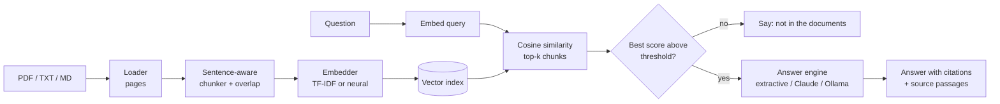

# DocBot: chat with your documents (RAG)

A small, well-tested **Retrieval-Augmented Generation** system in Python. Upload PDFs or
text files, ask questions in plain English, and get answers that **cite the exact passages**
they came from. If the documents don't contain the answer, DocBot says so instead of guessing.

It runs fully offline by default (no API key, no model download) and can switch to Claude or a
local Ollama model for fluent answers.

## Features

- **Sentence-aware chunking** with overlap, so facts are never cut in half and every chunk keeps its file and page number.
- **Pluggable embeddings**: TF-IDF (offline, default) or Sentence-Transformers (semantic).
- **Pluggable answer engines**: extractive (no model), Claude via the Anthropic API, or any local model through Ollama.
- **Grounded answers**: the model only sees passages above a relevance threshold, must cite them as `[1]`, `[2]`, and the UI shows each source with its score.
- **Refuses out-of-scope questions** instead of hallucinating (and skips the LLM call, saving cost).
- **Built-in evaluation**: hit@k, MRR, and refusal accuracy on a labelled question set, with an equal-context comparison across chunk sizes.
- Streamlit chat UI, CLI, Dockerfile, GitHub Actions CI, 50+ automated tests.

## How it works



## Quick start

```bash
pip install -r requirements.txt

# 1. Web app (sample study notes are preloaded; upload your own PDFs in the sidebar)
streamlit run app.py

# 2. Command line
python cli.py ask data/sample_docs "What is thrashing?"
python cli.py chat data/sample_docs

# 3. Tests and evaluation
pip install -r requirements-dev.txt
pytest
python -m docbot.evaluate
```

### Better answers with Claude or a local model

```bash
pip install -r requirements-optional.txt        # anthropic + sentence-transformers

export ANTHROPIC_API_KEY=...                    # then pick "Claude" in the app sidebar
python cli.py ask data/sample_docs "How does TCP slow start work?" --llm anthropic

ollama pull llama3.2                            # fully local alternative
python cli.py ask data/sample_docs "What is a deadlock?" --llm ollama
```

Use `--embedder sentence-transformers` (or the sidebar dropdown) for semantic search.
The model can be changed with `DOCBOT_ANTHROPIC_MODEL` / `DOCBOT_OLLAMA_MODEL`.

### Docker

```bash
docker build -t docbot .
docker run -p 8501:8501 -e ANTHROPIC_API_KEY=... docbot
```

## Evaluation

`data/eval_questions.json` has 28 answerable questions (each with an `evidence` phrase that
the retrieved chunk must contain) and 6 unanswerable ones. Results with TF-IDF retrieval
(`python -m docbot.evaluate`):

| Embedder | Chunk size | Overlap | Chunks | hit@1 | hit@3 | hit@5 | hit@1600ch | MRR | Refuses unanswerable | Wrongly refuses |
|---|---|---|---|---|---|---|---|---|---|---|
| tfidf | 200 | 30 | 89 | 75% | 96% | 96% | 96% | 0.851 | 83% | 0% |
| tfidf | 400 | 60 | 39 | 86% | 96% | 96% | 96% | 0.906 | 83% | 0% |
| tfidf | 600 | 90 | 27 | 86% | 100% | 100% | 100% | 0.917 | 83% | 0% |
| tfidf | 800 | 120 | 21 | 93% | 96% | 96% | 93% | 0.943 | 83% | 0% |
| tfidf | 1200 | 180 | 14 | 100% | 100% | 100% | 100% | 1.000 | 83% | 0% |

`hit@1600ch` gives every configuration the same context budget (the best chunks that fit in
1,600 characters).

**How to read this honestly**

- A first version of this table only had hit@k, and it made large chunks look clearly best.
  That was partly an artifact: top-5 of 1,200-character chunks hands the model about six times
  more text than top-5 of 200-character chunks. The equal-context column removes that
  advantage, and the differences shrink to a single question (1 of 28 = 3.6 points).
- So on this corpus chunk size mostly affects **ranking** (MRR rises with size because each
  chunk is close to a whole topical section), not whether the answer is found. The default of
  600 characters is a middle value, not a proven optimum. Re-run the sweep on your own documents.
- The question set is small and was written by the same author as the sample notes, so absolute
  scores are optimistic. Treat it as a regression harness and a method, not a benchmark.

## Known limitations

- **Lexical mismatch (TF-IDF).** "Why does chunk size matter for retrieval?" is missed at
  200-character chunks because the notes say "chunk*s* matter*s*" and TF-IDF has no stemming. Semantic embeddings are the intended fix.
- **Topically-adjacent questions slip through.** "How do I deploy a neural network on a GPU
  cluster?" shares real vocabulary with the ML notes, scores 0.12, and is not refused (hence 83% = 5 of 6). The relevance threshold (0.05) was set just below the lowest score of any genuine question in the sample set (0.079), so it refuses none of them, but it cannot reject every near-miss. Tune it for your own documents.
- The semantic-embedding threshold (0.30) is an uncalibrated starting point. Run
  `python -m docbot.evaluate --embedder sentence-transformers` and adjust.
- Headings are not detected: a heading line stays attached to the sentence after it (you can see this in extractive answers). It does not hurt retrieval, but it is cosmetically rough; LLM answers rephrase it away.
- No persistent index (rebuilt on each start; fast for small corpora), no OCR for scanned PDFs, and no conversation memory: each question is answered independently.
- The Claude and Ollama backends are covered by unit tests with stand-ins for the SDK and the server. Try them once with a real key / running model before relying on them.

## Project layout

```
app.py                  Streamlit chat UI
cli.py                  ask / chat / eval commands
docbot/
  loader.py             PDF/TXT/MD -> (page, text)
  chunker.py            sentence-aware chunking with overlap
  embeddings.py         TF-IDF and Sentence-Transformers embedders
  retriever.py          cosine-similarity vector index
  llm.py                extractive, Claude and Ollama answer engines
  pipeline.py           RAGPipeline: ties everything together
  evaluate.py           hit@k / MRR / refusal evaluation and chunk-size sweep
data/                   sample study notes + labelled evaluation questions
tests/                  chunking, loading, retrieval, backends, pipeline, eval, UI smoke tests
```

## Ideas for extending it

- Hybrid retrieval (BM25 + embeddings) and a cross-encoder reranker.
- A persistent vector store (FAISS or Chroma) so large collections load instantly.
- Measure answer faithfulness, not just retrieval (e.g. have a judge model check each cited claim).
- Streaming answers, conversation memory, and OCR for scanned PDFs.

## Deploying

Push to GitHub and deploy on [Streamlit Community Cloud](https://streamlit.io/cloud) or a
Hugging Face Space (choose the Streamlit SDK). Both read `requirements.txt` and `app.py`
from the repository root. Add `ANTHROPIC_API_KEY` as a secret if you want the Claude backend.
